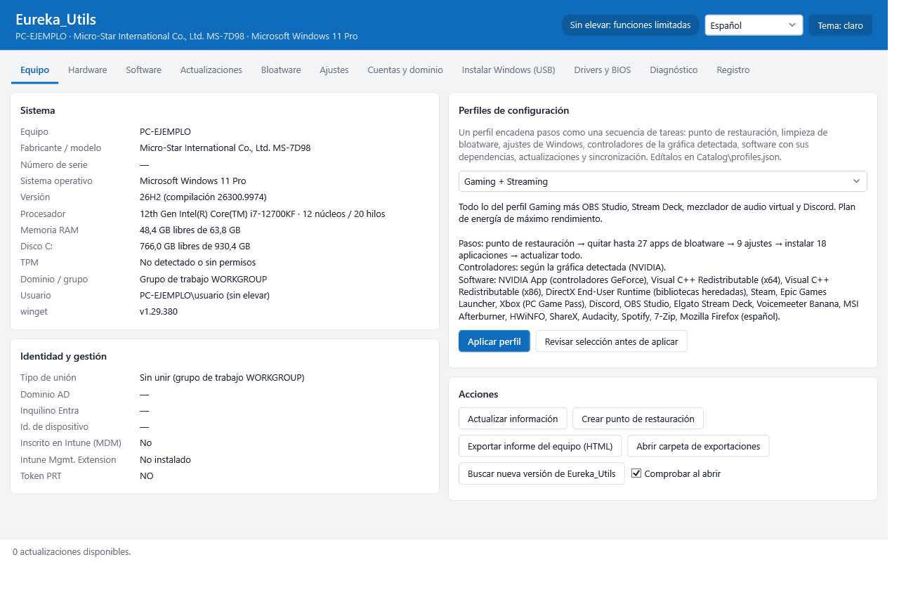
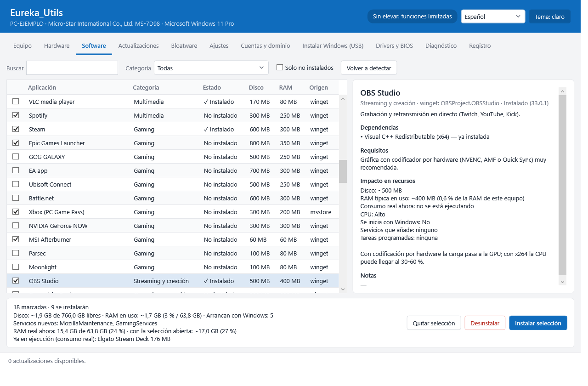
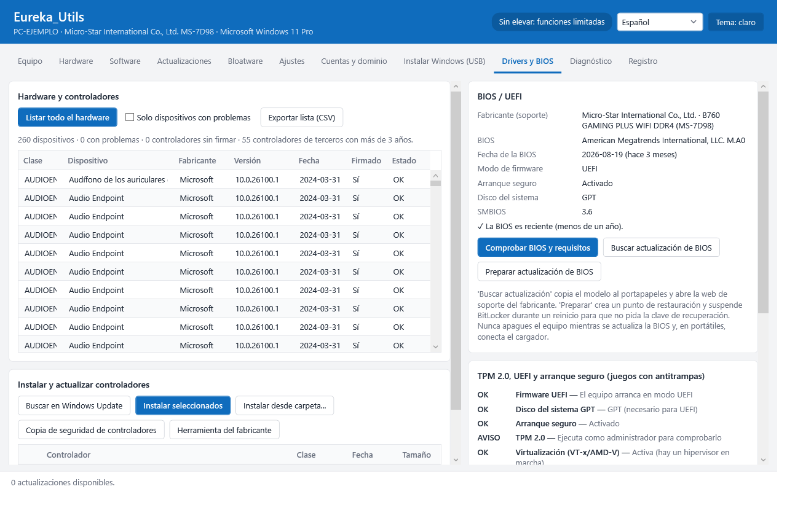
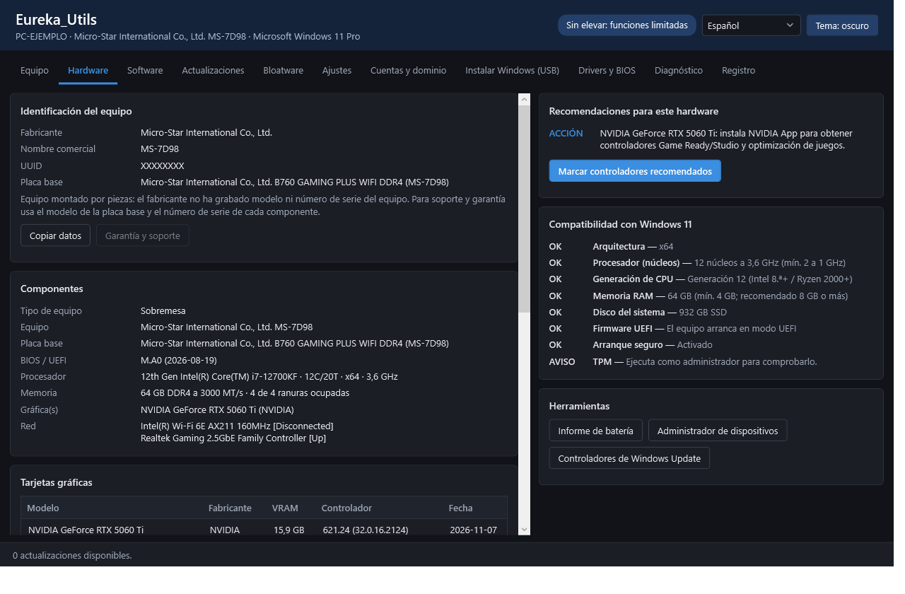

# Eureka_Utils · Configurador de equipos

*English summary [below](#english).*

Herramienta portable para preparar, auditar y diagnosticar equipos Windows 11 de uso personal y profesional. Detecta el hardware (incluida la tarjeta gráfica NVIDIA/AMD/Intel), quita bloatware, instala software explicando sus dependencias y su consumo de recursos, mantiene todo actualizado con winget, aplica ajustes, configura cuentas (con verificación en dos pasos), une el equipo a Active Directory o a Microsoft Entra ID, sincroniza con Intune, diagnostica el sistema y busca malware, y crea USB de instalación de Windows 11 que dejan el equipo configurado sin intervención.

**Versión 2.3.0 · noviembre de 2026**

| Equipo y perfiles | Software con consumo real de RAM |
|---|---|
|  |  |
| **Drivers, BIOS y TPM/UEFI** | **Hardware (modo oscuro)** |
|  |  |
## Características

- **Hardware**: identificación del equipo de marca (nombre comercial, número de serie, Machine Type/MTM de Lenovo, Service Tag de Dell, número de producto de HP) con acceso a la garantía; detección de CPU, RAM, discos, red y GPU, con recomendaciones de controladores y comprobación de compatibilidad con Windows 11 (TPM 2.0, UEFI, arranque seguro).
- **Software**: catálogo estilo Centro de software con dependencias, requisitos e impacto en disco y RAM antes de instalar, calculado sobre el **consumo real de RAM** de lo que ya se está ejecutando en el equipo.
- **Drivers y BIOS**: listado de todo el hardware con su controlador (versión, fecha, firma y estado), controladores y firmware desde Windows Update, instalación desde carpeta, copia de seguridad de controladores y herramientas oficiales de Dell, HP, Lenovo e Intel. Versión y antigüedad de la BIOS con enlace al soporte del fabricante y preparación segura de la actualización (punto de restauración y BitLocker suspendido).
- **TPM 2.0, UEFI y arranque seguro (gaming)**: comprobación de los requisitos de los antitrampas (Valorant, Call of Duty, Battlefield 6), conversión MBR → GPT con MBR2GPT, reinicio directo en la BIOS e instrucciones según el fabricante (MSI, ASUS, Gigabyte, ASRock, Dell, HP, Lenovo, Acer).
- **Actualizaciones**: `winget upgrade` al abrir, con opción de actualizar todo o solo lo seleccionado. Después se **comprueba el resultado** y, si una aplicación no se ha actualizado, se avisa y se ofrece su **enlace de descarga manual**.
- **Bloatware**: retirada de apps preinstaladas con indicación del riesgo (bajo, medio, alto) y posibilidad de reinstalarlas.
- **Ajustes de Windows**: energía, gaming, explorador, privacidad, seguridad y administración.
- **Perfiles**: Personal, Oficina (Microsoft 365), Oficina IT (sistemas, soporte y ciberseguridad), Gaming, Gaming + Streaming, Creativo, Desarrollo, Estudiante y Equipo básico.
- **Cuentas y dominio**: cuentas locales, unión a Active Directory o Entra ID (la contraseña y el MFA los gestiona Microsoft; Eureka_Utils no los guarda), sincronización con Intune, unión híbrida y exportación del hash de Autopilot.
- **Diagnóstico**: estado del sistema operativo, SFC, DISM, CHKDSK, diagnóstico de memoria y errores recientes.
- **Antivirus y malware**: estado de Microsoft Defender, análisis rápido, completo, de una carpeta o USB y sin conexión, y Microsoft Safety Scanner portátil para llevar en el USB.
- **Consolas MMC**: acceso directo a las consolas de administración de Windows (y a las de RSAT si están instaladas).
- **USB de instalación**: formatea e instala Windows 11 y deja el equipo configurado con el perfil elegido.
- **Idiomas y tema**: interfaz en español, inglés, francés, portugués, euskera, catalán, valenciano y gallego, en modo claro u oscuro.
- **Informe**: exportación del estado del equipo en HTML.
- **Actualización de Eureka_Utils**: aviso cuando hay una versión nueva y descarga verificada con la huella SHA-256 que publica GitHub (no sustituye nada por su cuenta).
- **Pruebas automáticas** en GitHub Actions: si fallan, no se publica la release.
- **Privacidad**: los registros e informes se guardan solo en el equipo; el botón **Borrar registros e informes** (pestaña Registro) los elimina.
- **Seguridad**: comprobación de integridad SHA-256 de los scripts en el lanzador, protección de la carpeta contra modificaciones sin permisos de administrador, instaladores locales verificados por hash o firma Authenticode y huellas SHA-256 de cada release.

## Requisitos

- Windows 11 y permisos de administrador.
- Windows PowerShell 5.1 (incluido en Windows). Interfaz WPF, sin dependencias externas.
- `winget` para instalar y actualizar software.

## Inicio rápido

1. Descarga `Eureka_Utils_Portable.exe` desde [Releases](https://github.com/juanraul86/Eureka_Utils/releases) (un solo archivo con todo dentro), o descarga el código con **Code > Download ZIP**.
2. Ejecuta `Eureka_Utils_Portable.exe`, o `Eureka_Utils.cmd` desde la carpeta del código, y acepta el aviso de administrador. Si Smart App Control bloquea el .exe (todavía no está firmado), usa `Eureka_Utils.cmd`.
3. Espera a que termine la detección y revisa las pestañas Hardware, Actualizaciones y Bloatware.
4. En la pestaña Equipo elige un perfil y pulsa **Revisar selección antes de aplicar** o **Aplicar perfil**.

También funciona sin interfaz, por ejemplo: `Eureka_Utils.cmd -Perfil "Oficina (Microsoft 365)" -Desatendido` o `Eureka_Utils.cmd -ActualizarTodo`.

## Documentación

La documentación completa (guía de instalación, manual de usuario, guía del USB de instalación de Windows y documentación técnica, en HTML y PDF con capturas) se distribuye en el paquete completo de Eureka_Utils. En este repositorio:

- [`CONTRIBUTING.md`](CONTRIBUTING.md): cómo informar de errores, proponer mejoras y colaborar con código.
- [`SECURITY.md`](SECURITY.md): cómo informar de un problema de seguridad.
- [`FIRMA-DE-CODIGO.md`](FIRMA-DE-CODIGO.md): estado y plan de la firma digital de los ejecutables.
- [`Packages/LEEME.txt`](Packages/LEEME.txt): cómo añadir instaladores propios o sin conexión.
- `Build/Build-Exe.ps1`: genera `Eureka_Utils.exe` y `Eureka_Utils_Portable.exe`.

## Comunidad y sugerencias

¿Echas algo en falta? Propón tu mejora o cuéntanos un problema en la pestaña [Issues](https://github.com/juanraul86/Eureka_Utils/issues).

Vídeos y novedades en las redes de Eureka_Utils: [YouTube](https://www.youtube.com/@eureka_utils) · [TikTok](https://www.tiktok.com/@eureka_utils) · [Instagram](https://www.instagram.com/eureka_utils/)

## De la misma familia

[Eureka_CloudSpeed](https://github.com/juanraul86/Eureka_CloudSpeed) ([web](https://juanraul86.github.io/Eureka_CloudSpeed/)): herramienta gratuita y portable para Windows que mide la latencia y la velocidad a 75 regiones de Azure y AWS, compara el estado de los servicios en la nube y exporta a Excel y Power BI.

## Aviso

Esta herramienta modifica el equipo (software, ajustes, cuentas, dominio). Toda acción que lo cambia pide confirmación y se puede crear un punto de restauración antes de aplicar cambios. Revisa el perfil y la selección antes de ejecutarlo en equipos de producción.

## English

**Eureka_Utils** is a free, portable, open-source (MIT) toolkit to set up, audit and troubleshoot Windows 11 PCs, for home users and IT technicians. Think of a lightweight, standalone take on the SCCM Software Center:

- **Profiles** that configure a PC end to end: restore point, bloatware removal, Windows tweaks, GPU drivers, software with its dependencies, updates and Intune sync (Office 365, IT, gaming, streaming, development, student, low-end PCs).
- **Software catalog** (110+ apps via winget) that shows dependencies, disk and CPU impact and **real RAM usage** before installing; verified `winget upgrade` with a manual download link (and its SHA-256) when an update fails.
- **Hardware, drivers and BIOS**: device identity (Lenovo MT/MTM, Dell Service Tag, HP product number) with warranty links, every device with its driver, driver and firmware updates from Windows Update, driver backup, BIOS age and safe update preparation.
- **Gaming readiness**: checks UEFI, GPT, Secure Boot and TPM 2.0 for kernel anti-cheats, MBR→GPT conversion and reboot to firmware with per-vendor steps.
- **Accounts and management**: local accounts, Active Directory, Microsoft Entra ID join with MFA, Intune sync, hybrid join and Autopilot hash export.
- **Diagnostics and security**: SFC, DISM, CHKDSK, Microsoft Defender scans (including offline), portable Microsoft Safety Scanner and MMC consoles.
- **Unattended Windows 11 install USB** that finishes the configuration on first logon.
- UI in English, Spanish, French, Portuguese, Basque, Catalan, Valencian and Galician, with light and dark themes.

**Get it:** download `Eureka_Utils_Portable.exe` from [Releases](https://github.com/juanraul86/Eureka_Utils/releases/latest) (run as administrator), or download the source and run `Eureka_Utils.cmd`. Executables are not code-signed yet, so Smart App Control may block them; the `.cmd` launcher always works. Every release lists the SHA-256 of its files.

Bug reports, ideas and pull requests are welcome: see [CONTRIBUTING.md](CONTRIBUTING.md). If you find Eureka_Utils useful, a ⭐ on GitHub helps a lot.
## Autor

Juan Raúl Ruiz · [LinkedIn](https://www.linkedin.com/in/juanraulruizbartran)

## Política de firma de código (Code signing policy)

**Estado actual: los ejecutables todavía no están firmados.** Por eso Windows muestra "Editor desconocido" y Smart App Control puede bloquearlos; en ese caso usa `Eureka_Utils.cmd` desde el código. Cada release publica la huella SHA-256 de sus ejecutables para comprobar que no se han alterado.

El plan es solicitar de nuevo la firma gratuita de [SignPath Foundation](https://signpath.org) para proyectos de código abierto cuando el proyecto tenga más difusión. La política que se aplicará:

- Los ejecutables se compilarán y firmarán automáticamente en **GitHub Actions** (`.github/workflows/release.yml`) a partir del código de este repositorio; nunca se firmarán binarios compilados fuera de ese proceso.
- **Equipo y funciones**
  - Autores (*committers*) y revisores (*reviewers*): [juanraul86](https://github.com/juanraul86)
  - Aprobadores de la firma (*approvers*): [juanraul86](https://github.com/juanraul86)
- Cada solicitud de firma la aprobará manualmente un aprobador. Las cuentas del equipo usan autenticación multifactor.
- Las versiones publicadas antes de activar la firma se indican como "sin firmar" en sus notas.
## Privacidad

Este programa no transfiere ninguna información a otros sistemas en red salvo que lo solicite expresamente el usuario o la persona que lo instala o lo utiliza. Las conexiones que realiza son las que el usuario lanza desde la interfaz: winget y Microsoft Store (instalar y actualizar software), los servicios de inicio de sesión de Microsoft (comprobar una cuenta profesional que el usuario escribe), la descarga de Microsoft Safety Scanner y las páginas web de descarga que el usuario abre. Además, al abrir consulta de forma anónima la última versión publicada en GitHub (`api.github.com`, sin datos del equipo); se desactiva con la casilla *Comprobar al abrir* de la pestaña Equipo. No incluye telemetría.

*This program will not transfer any information to other networked systems unless specifically requested by the user or the person installing or operating it.*

## Licencia

[MIT](LICENSE)

